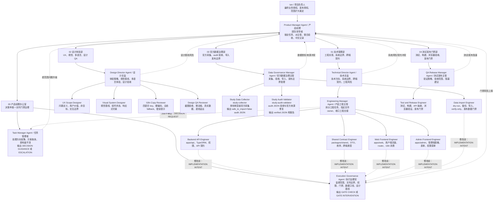
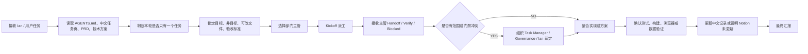
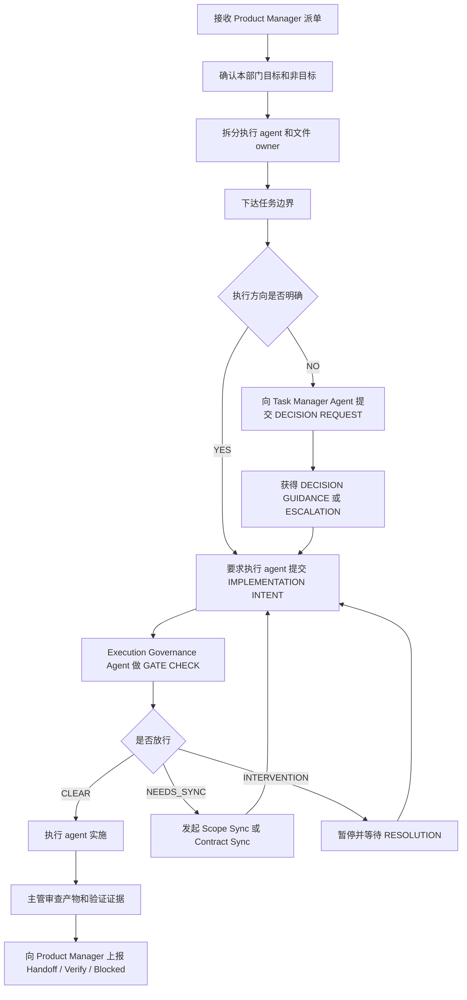
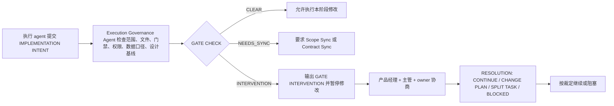
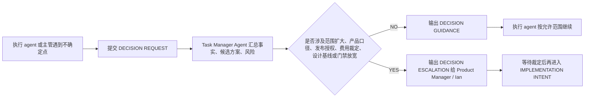
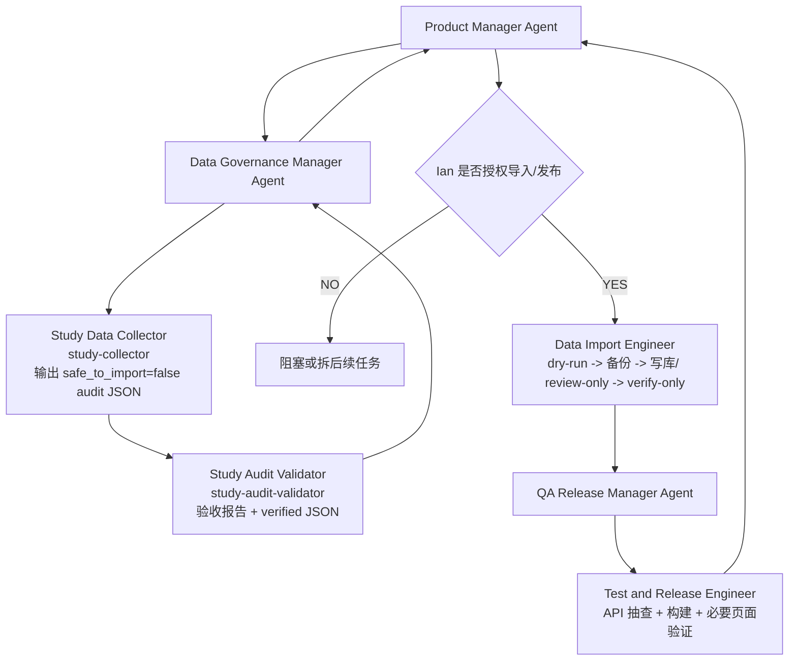
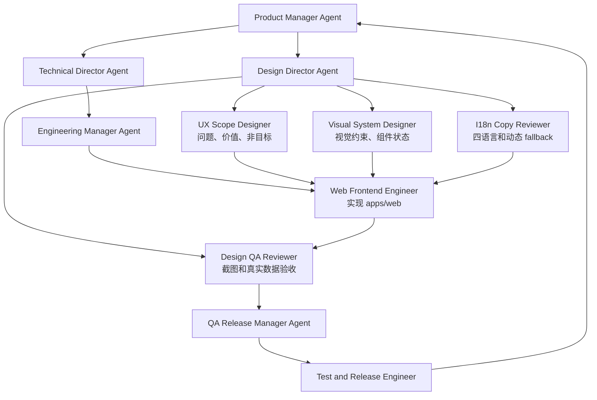
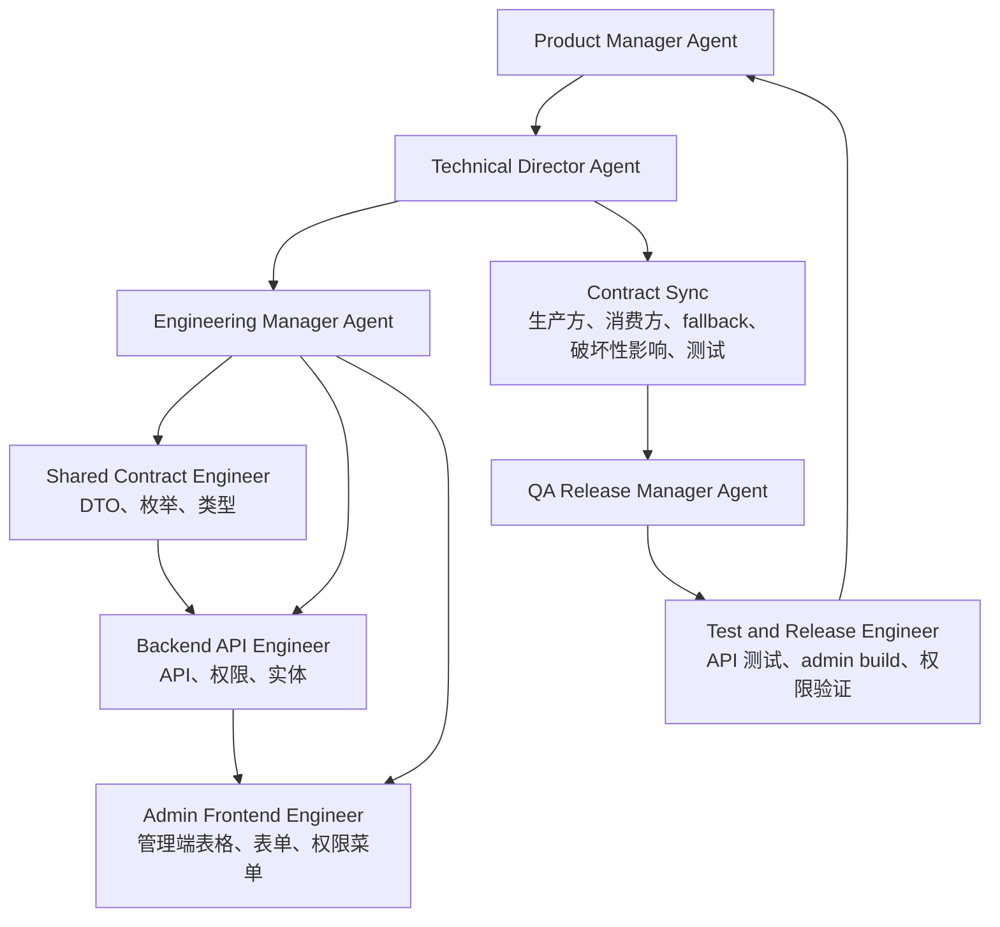

# StudyMY Codex 单任务交付团队组织架构图

本文档是团队结构总图，用于配置 WorkBuddy、检查岗位职责、执行任务前 Kickoff 和任务结束后的复盘。正式团队名称为 `StudyMY Codex 单任务交付团队`。

## 1. 组织架构长图



## 2. 岗位职责总表

| Agent | 层级 | 直属上级 | 下级或协作对象 | 核心职责 | 必须输出 | 禁止事项 |
| --- | --- | --- | --- | --- | --- | --- |
| Product Manager Agent | 团队领导者 | Ian | 所有主管 | 锁定任务、事实来源、范围、非目标、验收标准；指挥主管；最终整合 | Kickoff、派工计划、最终报告、中文记录状态 | 同时推进多个任务；绕过事实来源；替 Ian 扩大范围或批准发布 |
| Task Manager Agent | 产品经理办公室 | Product Manager Agent | 所有主管和执行 agent | 处理方向犹豫、方案取舍、影响面不清 | `DECISION GUIDANCE` 或 `DECISION ESCALATION` | 写业务代码；替 Ian 或产品经理扩大范围 |
| Execution Governance Agent | 产品经理办公室 | Product Manager Agent | 所有执行 agent | 实时检查范围、文件边界、门禁、权限、数据口径和设计基线 | `GATE CHECK`、`GATE INTERVENTION`、`RESOLUTION PROPOSAL` | 私自放宽门禁；替执行 agent 写代码 |
| Technical Director Agent | 部门总监 | Product Manager Agent | Engineering Manager Agent | 技术方向、系统边界、跨端契约、工程风险 | 技术拆解、影响面、Contract Sync 要点 | 绕过产品经理改优先级；批准写库或发布 |
| Engineering Manager Agent | 部门主管 | Technical Director Agent | Backend、Shared、Web、Admin | 拆工程任务、指定文件 owner、收口工程交接 | 文件 owner 清单、工程交接、阻塞上报 | 多人同时写同一文件；降低测试门禁 |
| Backend API Engineer | 执行 agent | Engineering Manager Agent | Shared、Web、Admin、Test | API、实体、权限、运行时契约 | 后端补丁、API 契约、测试结果 | 绕过数据审计；私自放宽公开数据门禁 |
| Shared Contract Engineer | 执行 agent | Engineering Manager Agent | Backend、Web、Admin、Test | DTO、枚举、类型、formatter、跨端契约 | shared 补丁、影响面、消费端同步清单 | 改字段含义但不同步消费端 |
| Web Frontend Engineer | 执行 agent | Engineering Manager Agent | Design QA、I18n、Test | 用户端页面、组件、状态、响应式和 i18n 消费 | web 补丁、构建/测试、截图说明 | 私自改 API、数据库、导入器或数据口径 |
| Admin Frontend Engineer | 执行 agent | Engineering Manager Agent | Backend、Test | 管理端表格、表单、权限菜单、运营流程 | admin 补丁、权限/表单验证 | 隐藏审核风险；绕过权限和数据范围 |
| Design Director Agent | 部门总监 | Product Manager Agent | UX、Visual、I18n、Design QA | 体验策略、视觉基线、多语言体验、设计验收 | 设计拆解、视觉约束、验收视口 | 未授权时推翻整体视觉系统 |
| UX Scope Designer | 执行 agent | Design Director Agent | Visual、Web、Design QA | 问题定义、用户价值、非目标、交互边界 | UX 范围、验收标准 | 没有任务边界就要求改页面 |
| Visual System Designer | 执行 agent | Design Director Agent | Web、Design QA | 视觉基线、组件状态、响应式约束 | 视觉方案、组件状态、token 建议 | 用无法承载真实数据的样式 |
| I18n Copy Reviewer | 执行 agent | Design Director Agent | Web、Design QA | 四语言 key、硬编码、动态 fallback、错误提示 | 缺失 key、硬编码清单、i18n 风险 | 把前端 fallback 当作数据层完成 |
| Design QA Reviewer | 执行 agent | Design Director Agent | Web、Test | 真实页面、真实数据、多语言、移动端验收 | 截图路径、复现路径、阻塞等级 | 只看中文桌面首屏 |
| Data Governance Manager Agent | 部门主管 | Product Manager Agent | Collector、Validator、Importer | 数据链路边界、授权、阶段交接和发布口径 | 数据风险、导入建议、授权清单 | 让 Collector/Validator 改代码；批准公开发布 |
| Study Data Collector | 执行 agent | Data Governance Manager Agent | Validator | 官方来源采集，单校单层级 | `safe_to_import=false` audit JSON、source registry、exception queue | 验收、导入、发布、改项目代码 |
| Study Audit Validator | 执行 agent | Data Governance Manager Agent | Collector、Importer | audit JSON 验收和官方来源修复 | 验收报告、verified JSON、diff 报告 | 改项目代码；把 `safe_to_import` 改为 true |
| Data Import Engineer | 执行 agent | Data Governance Manager Agent | Backend、Test | dry-run、备份、导入、verify-only、发布数据门禁 | dry-run 报告、备份路径、导入/验证报告 | 绕过 Validator；无授权写库或公开 |
| QA Release Manager Agent | 部门主管 | Product Manager Agent | Test and Release Engineer | 验证策略、验收范围、发布门禁 | 验证计划、失败项、发布/阻塞建议 | 忽略失败项；替 Ian 批准发布 |
| Test and Release Engineer | 执行 agent | QA Release Manager Agent | 所有执行 agent | 测试、构建、API 抽查、浏览器验收、发布门禁 | 命令、结果、失败项、截图或报告路径 | 用“看起来没问题”替代验证 |

## 3. 上传下达规则

每个主管必须严格履行三段式管理：

```text
接收上级任务
  -> 拆解本部门执行分工
  -> 下达目标、非目标、可改文件、禁止事项、验收标准
  -> 监督执行 agent 提交 IMPLEMENTATION INTENT 或 DECISION REQUEST
  -> 收集产物、测试证据、风险、阻塞
  -> 向上级汇报结论和建议
```

主管不允许只做“传话筒”。主管必须做专业判断：任务是否拆得动、风险是否可控、是否需要跨部门同步、是否需要产品经理或 Ian 裁定。

## 4. Product Manager 工作流



## 5. 主管工作流



## 6. 执行治理工作流



## 7. 任务管理工作流



## 8. 数据链路工作流



## 9. UI/设计链路工作流



## 10. 后端/管理端工作流



## 11. 最小执行纪律

1. 产品经理必须先读事实来源，再派主管。
2. 主管必须先拆分边界，再安排执行 agent。
3. 执行 agent 修改前必须提交 `IMPLEMENTATION INTENT`。
4. 方向不确定必须提交 `DECISION REQUEST`。
5. 跨端、跨字段、跨数据口径必须做 `Contract Sync`。
6. 阶段产物必须做 `Handoff`。
7. 验证必须输出 `VERIFY`，不能只说“通过”。
8. 主管必须上传阻塞和风险，不能私下裁定超范围事项。
9. 产品经理必须最终汇总，不能让执行 agent 自行宣布完成。
10. 真实 Notion 未更新时，必须明确说明，并更新本地中文开发记录。
